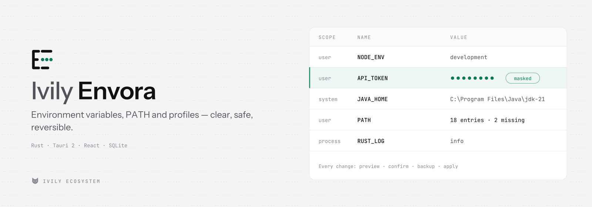
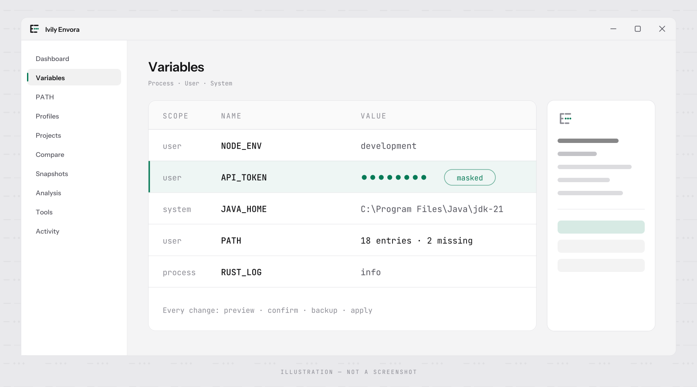
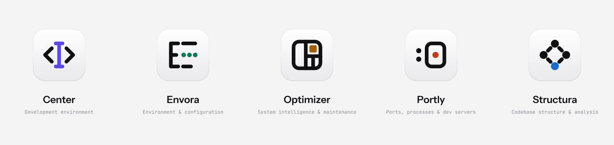

<p align="center">
  <picture>
    <source media="(prefers-color-scheme: dark)" srcset="assets/brand/banners/ivily-envora-readme-banner-dark.svg">
    
  </picture>
</p>

<p align="center">
  <b>Türkçe</b> · <a href="#english">English</a>
  &nbsp;|&nbsp;
  <a href="https://github.com/efecrtgl/ivily-envora/releases/latest">İndir</a> ·
  <a href="docs/KULLANIM.md">Kullanım</a> ·
  <a href="docs/GUVENLIK.md">Güvenlik</a> ·
  <a href="ROADMAP.md">Yol haritası</a>
</p>

<p align="center">
  <a href="https://github.com/efecrtgl/ivily-envora/actions/workflows/ci.yml"></a>
  <a href="https://github.com/efecrtgl/ivily-envora/releases/latest"></a>
  <a href="LICENSE"></a>
</p>

**Ivily Envora**, Windows için açık kaynaklı bir ortam değişkeni, PATH ve geliştirme ortamı yöneticisidir. Ortam değişkenlerini, PATH girdilerini, ortam profillerini ve proje ortamlarını **anlaşılır, güvenli ve geri alınabilir** biçimde yönetmenizi sağlar. Ivily ekosisteminin bir parçasıdır, ancak tek başına — hiçbir başka uygulamaya ihtiyaç duymadan — çalışır.

> [!NOTE]
> **Durum:** Yayımlanan son sürüm **[0.1.0](https://github.com/efecrtgl/ivily-envora/releases/tag/v0.1.0)**. Yol haritasındaki 22 aşamanın tamamı tamamlandı; ayrıntılar [CHANGELOG.md](CHANGELOG.md) ve [ROADMAP.md](ROADMAP.md) belgelerinde.

<p align="center">
  <picture>
    <source media="(prefers-color-scheme: dark)" srcset="assets/brand/illustrations/ivily-envora-product-visual-dark.svg">
    
  </picture>
  <br><sub><i>Çizimdir, ekran görüntüsü değildir.</i></sub>
</p>

## Her değişiklik aynı güvenli yoldan geçer

```
 önizle  ──►  onayla  ──►  otomatik yedek  ──►  uygula  ──►  hata olursa geri al
```

Sistem kapsamındaki bir değişiklik için uygulamanın tamamı değil, **yalnızca o işlem** yönetici olarak (UAC) çalıştırılır.

## Özellikler

### Gör ve anla

- **Değişkenler** — İşlem, kullanıcı ve sistem kapsamlarını ayrı ayrı görün; arayın, süzün. `REG_SZ` / `REG_EXPAND_SZ` türü korunur.
- **PATH yöneticisi** — Bulunamayan, yinelenen, göreli ve çözülemeyen girdileri gösterir; hangi programın hangi kopyasının çalıştığını (komut çakışmaları) açıklar.
- **Analiz** — 23 kurallık, yapılandırılabilir analiz motoru; sorunları açıklar ama **otomatik düzeltmez**.
- **Araç keşfi** — Node.js, Python, Rust, Java, Go, .NET, Git, Docker ve diğerlerinin sürüm ve konumları.
- **Karşılaştırma** — Kapsamları, profilleri, projeleri, anlık görüntüleri ve içe aktarılan dosyaları yan yana.

### Düzenle ve uygula

- **Değişken yönetimi** — Oluşturun, düzenleyin, çoğaltın, yeniden adlandırın, silin; PATH girdilerini sıralayın ve düzenleyin.
- **Profiller** — Yeniden kullanılabilir değişken ve PATH kümeleri; sürüm geçmişi, doğrulama, kalıcı uygulama ve tek tıkla geri alma.
- **Projeler** — Proje dizinlerini profillerle ve projeye özgü değişkenlerle eşleştirin; bir terminali veya tanımladığınız programı proje ortamıyla, **yalnızca açık onayla** başlatın.
- **Şablonlar** — Yaygın geliştirme ortamları için gizli değer içermeyen öneriler.

### Koru ve geri al

- **Gizli değer koruması** — Token, parola ve anahtar gibi hassas değerler algılanır, maskelenir ve yalnızca istendiğinde gösterilir; arayüze, etkinlik kaydına, hata mesajlarına ve dışa aktarmalara sızmaz. Uygulama içinde saklananlar **Windows DPAPI** ile şifrelenir.
- **Anlık görüntüler ve yedekleme** — Ortamın belirli anlardaki kaydı; seçimli ve önizlemeli geri yükleme; veritabanı yedeği.
- **İçe / dışa aktarma** — JSON, CSV, `.env` ve PATH listesi. İçe aktarılan içerik **asla çalıştırılmaz**.
- **Pano ve etkinlik merkezi** — Anlamlı özetler ve değer içermeyen yerel işlem kaydı.

**Türkçe ve İngilizce** arayüz, açık/koyu tema, imzalı uygulama içi güncellemeler.

## Kurulum

[Sürümler](https://github.com/efecrtgl/ivily-envora/releases/latest) sayfasından `Ivily Envora_<sürüm>_x64-setup.exe` dosyasını indirip çalıştırın. Kurulum **yönetici yetkisi gerektirmez**. Ayrıntılar: [docs/KURULUM.md](docs/KURULUM.md).

**Gereksinimler:** Windows 10 (1809+) veya Windows 11, x64 · Microsoft Edge WebView2 (Windows 11'de hazır gelir; gerekirse kurulum programı indirir).

## Mimari

```
WebView2 · React (düz JavaScript)      ── yalnızca lib/api.js üzerinden IPC ──►
Rust çekirdeği · Tauri 2               commands/ → env · pathmgr · security (DPAPI) · profiles ·
                                       projects · snapshots · compare · io · analysis · discovery
                                       · activity · db (SQLite) · iep
```

Aynı yürütülebilir dosyanın üç kipi vardır: normal uygulama, sistem kapsamı için UAC ile başlatılan arayüzsüz yardımcı (`--envora-elevated-apply`) ve Ivily Ecosystem Protocol yanıtlayıcısı (`--iep`). Ayrıntılar: [docs/MIMARI.md](docs/MIMARI.md).

**Teknolojiler:** Rust · Tauri 2 · React (düz JavaScript) · SQLite · Vite · Vitest

## Kaynaktan derleme

**Gereksinimler:** Windows 10/11 x64 · Rust (kararlı, 1.82+, MSVC) · Node.js 22+ · WebView2.

```powershell
npm ci
npm run tauri dev      # geliştirme kipi
npm test               # arayüz testleri
cd src-tauri; cargo test
```

Ayrıntılar: [docs/GELISTIRME.md](docs/GELISTIRME.md).

## Belgeler

| Kullanıcılar için | Geliştiriciler için |
|---|---|
| [Kurulum ve güncelleme](docs/KURULUM.md) | [Geliştirme ortamı](docs/GELISTIRME.md) |
| [Kullanım kılavuzu](docs/KULLANIM.md) | [Mimari](docs/MIMARI.md) |
| [Ortam değişkenleri rehberi](docs/rehber/ORTAM-DEGISKENLERI.md) | [Veritabanı](docs/VERITABANI.md) |
| [PATH rehberi](docs/rehber/PATH.md) | [Testler](docs/TEST.md) |
| [Profiller](docs/rehber/PROFILLER.md) | [Performans ölçümleri](docs/PERFORMANS.md) |
| [Proje ortamları](docs/rehber/PROJELER.md) | [Ivily Ecosystem Protocol](docs/IEP.md) |
| [Yedekleme ve geri yükleme](docs/rehber/YEDEKLEME.md) | [Sürüm yayımlama](docs/SURUM.md) |
| [İçe ve dışa aktarma](docs/rehber/ICE-DISA-AKTARMA.md) | [Yol haritası](ROADMAP.md) |
| [Güvenlik ve sınırlamalar](docs/GUVENLIK.md) | [Katkıda bulunma](CONTRIBUTING.md) |
| [Sorun giderme](docs/SORUN-GIDERME.md) | [Değişiklik günlüğü](CHANGELOG.md) |

## Güvenlik ve gizlilik

Ivily Envora telemetri göndermez ve güncelleme denetimi dışında ağa bağlanmaz. Tehdit modeli ve bilinen sınırlamalar [docs/GUVENLIK.md](docs/GUVENLIK.md) belgesindedir. Güvenlik açıklarını [SECURITY.md](SECURITY.md) belgesindeki yolla özel olarak bildirin.

## Ivily ekosistemi

<p align="center">
  <picture>
    <source media="(prefers-color-scheme: dark)" srcset="assets/brand/ecosystem/ivily-ecosystem-lineup-dark.svg">
    
  </picture>
</p>

Envora, [Ivily Center](https://github.com/efecrtgl/ivily-center-main) tarafından isteğe bağlı olarak okunabilir: uygulamanın arayüzsüz `--iep` kipi, standart girdiden gelen tek bir yerel, salt okunur **Ivily Ecosystem Protocol** isteğini yanıtlar — arka plan servisi ve ağ bağlantısı yoktur ([docs/IEP.md](docs/IEP.md)). Diğer ürünler: [Optimizer](https://github.com/efecrtgl/ivily-optimizer) · [Portly](https://github.com/efecrtgl/ivily-portly) · [Structura](https://github.com/efecrtgl/ivily-structura).

## Katkı ve lisans

Katkılar memnuniyetle karşılanır: [CONTRIBUTING.md](CONTRIBUTING.md) · [Davranış kuralları](CODE_OF_CONDUCT.md). Marka varlıkları (logo, simge, bant, kullanım kuralları): [`assets/brand/`](assets/brand/README.md).

[MIT](LICENSE) © 2026 efecrtgl

---

## English

<a id="english"></a>

**Ivily Envora** is an open-source Windows desktop app for managing environment variables, PATH entries, environment profiles and project environments — clearly, safely and reversibly. It is part of the Ivily ecosystem but fully usable on its own. Latest release: **[0.1.0](https://github.com/efecrtgl/ivily-envora/releases/tag/v0.1.0)**.

- **Inspect and edit** process, user and system variables. Every persistent change is **previewed, confirmed, backed up first and rolled back on failure**. Only the system-scope change itself is elevated (UAC).
- **Secrets stay secret.** Tokens, passwords and keys are detected, masked, revealed only on request, never written to logs, errors or exports by default, and encrypted with Windows DPAPI when stored by the app.
- **PATH manager** with missing/duplicate/relative entry detection and executable conflict analysis.
- **Profiles** with version history and reversible activation; **project environments** with consented launching.
- Comparison, snapshots, JSON/CSV/`.env` import & export (imported content is never executed), a configurable 23-rule analysis engine, developer tool discovery, templates, dashboard and a local activity log.
- Turkish (primary) and English UI, light/dark themes, signed in-app updates from GitHub Releases. No telemetry.

**Install:** download the installer from [Releases](https://github.com/efecrtgl/ivily-envora/releases/latest) — no administrator rights needed. Requires Windows 10 (1809+) or 11, x64, and WebView2.
**Docs:** user documentation is in Turkish; an English guide is available in [docs/en/GUIDE.md](docs/en/GUIDE.md).
**Build:** `npm ci`, `npm run tauri dev`, `npm test`, `cd src-tauri; cargo test` (Rust 1.82+, Node.js 22+).
